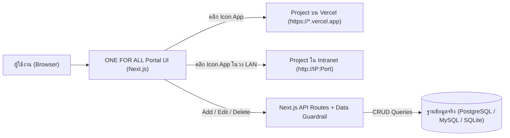

# Software Requirements Specification (SRS)
## โครงการ: ONE FOR ALL (little-ong) — Unified Cloud & Intranet Application Portal

---

### 1. ที่มาและวัตถุประสงค์ (Background & Objectives)
ในปัจจุบันมีการพัฒนาและ Deploy เว็บแอปพลิเคชันและระบบงานต่างๆ กระจายอยู่หลายสภาพแวดล้อม ทั้งบนเครือข่ายภายในองค์กร/โรงพยาบาล (**Intranet IP:Port**) และบนระบบคลาวด์ (**Vercel / Cloud URL**) ทำให้ผู้ใช้งานและผู้ดูแลระบบต้องจดจำ URL, หมายเลข IP Address และ Port จำนวนมาก ซึ่งไม่สะดวกต่อการเข้าถึงและบริหารจัดการ

**วัตถุประสงค์ของโครงการ:**
1. สร้างหน้าต่างศูนย์กลาง (**Centralized App Launchpad / Portal**) ที่มีดีไซน์สวยงาม ทันสมัย คล้ายหน้าจอ App Drawer บน OS/Cloud Portal
2. สามารถเข้าถึงผ่านระบบ Cloud (เช่น Deploy บน Vercel) จากที่ใดก็ได้ แล้วคลิกที่ **Icon ของ App** เพื่อเปิดไปยังโปรเจกต์ปลายทาง (ทั้ง URL ปกติ และ `http://<IP>:<Port>`) ได้ทันที
3. มีระบบบริหารจัดการรายการแอปพลิเคชัน (**Add / Edit / Delete**) ปรับแต่งไอคอน หมวดหมู่ และรายละเอียดได้เองผ่านหน้าเว็บโดยไม่ต้องแก้โค้ด
4. เก็บข้อมูลลงฐานข้อมูลจริง (**Real Database Persistence**) เพื่อให้เปิดจากเครื่องใดก็ได้เห็นรายการแอปชุดเดียวกันทั้งหมด โดยปฏิบัติตาม **Zero Mockup Policy** อย่างเคร่งครัด

---

### 2. ขอบเขตของระบบและฟีเจอร์หลัก (Core Features & Functional Requirements)

#### FR-01: หน้าต่างศูนย์รวมแอปพลิเคชัน (App Launchpad Grid UI)
- แสดงรายการแอปพลิเคชันในรูปแบบ **App Icon Grid / Glassmorphism Cards** ที่สวยงาม รองรับ Responsive Design (Desktop, Tablet, Mobile)
- เมื่อคลิกที่ไอคอนหรือการ์ดของแอป ระบบจะเปิดลิงก์ปลายทาง (`target="_blank"` หรือเลือกเปิดหน้าต่างใหม่) ไปยัง URL หรือ `IP:Port` ที่ตั้งค่าไว้ทันที
- แสดงป้ายกำกับ (Badge) แยกชัดเจนระหว่างแอปประเภท **Intranet (LAN/IP:Port)**, **Vercel (Cloud)** หรือ **External/Other**
- แสดงรายละเอียดสำคัญบนการ์ดอย่างกระชับ เช่น ชื่อแอป, คำอธิบายสั้นๆ, หมวดหมู่ และ URL/IP:Port ปลายทาง (พร้อมปุ่ม Copy URL ด่วน)
- กรณีฐานข้อมูลยังไม่มีรายการแอปพลิเคชัน (0 records) ระบบจะแสดงสถานะว่าง (`"ไม่มีรายการแอปพลิเคชัน"` / `0 รายการ`) พร้อมปุ่มกดเพิ่มแอปแรกทันที (**ห้ามแสดงข้อมูลตัวอย่างหรือ Mock Data เด็ดขาด**)

#### FR-02: ระบบจัดการแอปพลิเคชันผ่านหน้าเว็บ (CRUD Management)
- **เพิ่มรายการแอป (Create):** ฟอร์มเพิ่มแอปใหม่ ประกอบด้วย:
  - ชื่อแอปพลิเคชัน (`name`) — *จำเป็น*
  - ลิงก์ปลายทาง (`url` หรือ `ip_address` + `port` ซึ่งระบบช่วยประกอบเป็น URL ที่ถูกต้องให้อัตโนมัติได้) — *จำเป็น*
  - ประเภทการติดตั้ง (`environment_type`): `Intranet`, `Vercel`, `Cloud`, หรือกำหนดเอง
  - หมวดหมู่งาน (`category`): เช่น ระบบงานเภสัชกรรม, ระบบวิเคราะห์ข้อมูล, ระบบบริหารจัดการ, ฯลฯ
  - ไอคอน (`icon`): เลือกจากคลังไอคอนมาตรฐาน (Lucide Icons), อัปโหลดรูป/URL รูปไอคอน หรือเลือกสีพื้นหลังไอคอน (`icon_color` / Gradient)
  - คำอธิบายเพิ่มเติม (`description`)
  - ลำดับการแสดงผล (`sort_order`) และการปักหมุด (`is_pinned`)
- **แก้ไขรายการแอป (Update):** แก้ไขข้อมูลทุกฟิลด์ของแอปที่มีอยู่ผ่าน Modal ได้ทันที
- **ลบรายการแอป (Delete):** มีหน้าต่างยืนยัน (Confirmation Modal) ก่อนลบรายการออกจากฐานข้อมูลจริง

#### FR-03: ระบบค้นหาและคัดกรอง (Search & Category Filtering)
- ช่องค้นหาแบบ Real-time (ค้นหาจากชื่อแอป, คำอธิบาย, IP, Port หรือ URL)
- แถบกรองตามสภาพแวดล้อม (`All`, `Intranet`, `Vercel / Cloud`) และตามหมวดหมู่งาน (`Category`)

#### FR-04: ระบบฐานข้อมูลและการเชื่อมต่อ (Database & Storage Architecture)
- รองรับการจัดเก็บข้อมูลจริงผ่าน API Backend (Next.js App Router API Routes):
  - **การใช้งานบน Vercel / Cloud:** รองรับการเชื่อมต่อฐานข้อมูล Cloud SQL / PostgreSQL (เช่น Neon / Supabase / Vercel Postgres) หรือ MySQL จริงผ่าน Environment Variable (`DATABASE_URL`)
  - **การใช้งานในเครื่อง / Local Server / Intranet:** รองรับ SQLite / MySQL จริง
  - มีระบบตรวจเช็คสถานะการเชื่อมต่อฐานข้อมูล (DB Connection Status Indicator) บนหน้าเว็บ หากฐานข้อมูลเชื่อมต่อไม่ได้ จะแสดงสถานะ `Disconnected` และแจ้งเตือนตามจริง (ไม่ใช้ Mock/Random Fallback)
- มีฟีเจอร์ **Export / Import JSON Backup** จากข้อมูลจริง เพื่อความสะดวกในการสำรองข้อมูลรายการแอป

#### FR-05: ระบบตรวจสอบคุณภาพข้อมูล (Data Guardrail & Zero Mockup Enforcement)
- มีโมดูลตรวจสอบข้อมูล (`Data Guardrail`) ป้องกันไม่ให้มีการบันทึกหรือแสดงผลข้อมูลที่มีลักษณะเป็น Mockup Signature (เช่น `example.com`, `dummy`, `test-mock`, `lorem ipsum`, `127.0.0.1:0000` ที่เป็นค่าจำลอง)

---

### 3. โครงสร้างข้อมูล (Database Schema Design)

ตาราง `applications` สำหรับเก็บข้อมูลโปรเจกต์และลิงก์ทั้งหมด:

| ชื่อคอลัมน์ (Field) | ประเภทข้อมูล (Type) | คำอธิบาย (Description) |
| :--- | :--- | :--- |
| `id` | `VARCHAR(36)` / `SERIAL` |รหัสอ้างอิงหลัก (Primary Key / UUID) |
| `name` | `VARCHAR(150)` | ชื่อโปรเจกต์ / แอปพลิเคชัน |
| `description` | `TEXT` | คำอธิบายสั้นๆ เกี่ยวกับระบบงาน |
| `environment_type` | `VARCHAR(50)` | สภาพแวดล้อม (`INTRANET`, `VERCEL`, `CLOUD`, `OTHER`) |
| `category` | `VARCHAR(100)` | หมวดหมู่ของแอปพลิเคชัน |
| `protocol` | `VARCHAR(10)` | `http` หรือ `https` |
| `host_or_url` | ` VARCHAR(500)` | URL เต็ม หรือ IP Address (เช่น `192.168.0.xxx` หรือ `my-app.vercel.app`) |
| `port` | `VARCHAR(10)` | หมายเลข Port (ถ้ามี เช่น `3000`, `8080`, เว้นว่างได้สำหรับ Vercel) |
| `path` | `VARCHAR(255)` | Path ต่อท้าย (ถ้ามี เช่น `/dashboard`) |
| `full_url` | `VARCHAR(1000)` | URL สมบูรณ์ที่พร้อมกดเปิดใช้งานทันที |
| `icon_name` | `VARCHAR(100)` | ชื่อไอคอน (Lucide Icon name หรือ Custom Image URL) |
| `icon_color` | `VARCHAR(50)` | โทนสีหรือ Gradient ของไอคอนแอป |
| `is_pinned` | `BOOLEAN` | สถานะปักหมุดแสดงด้านบนสุด |
| `sort_order` | `INT` | ลำดับการจัดเรียง |
| `created_at` | `TIMESTAMP` | วันเวลาที่สร้างรายการ |
| `updated_at` | `TIMESTAMP` | วันเวลาที่แก้ไขล่าสุด |

---

### 4. สถาปัตยกรรมและการไหลของระบบ (System Architecture)

---

### 5. ข้อกำหนดที่ไม่ใช่ฟังก์ชัน (Non-Functional Requirements)
1. **UI/UX Design:** ออกแบบสไตล์ **macOS Launchpad / Modern Cloud OS Dashboard** ใช้โทนสีที่สบายตา รองรับ Dark/Light Mode มีแอนิเมชันนุ่มนวลเวลา Hover ที่ไอคอนแอป
2. **Performance:** โหลดหน้าเว็บเริ่มต้นรวดเร็ว แสดงจำนวนแอปตามจริงจากฐานข้อมูล
3. **Security & Zero Mockup Policy:**
   - ห้ามมีข้อมูลจำลอง (Zero Mockup Data) ฝังอยู่ในโค้ด
   - หากยังไม่ได้ตั้งค่าฐานข้อมูลหรือเชื่อมต่อฐานข้อมูลไม่สำเร็จ ต้องแสดงข้อความแจ้งเตือนสถานะการเชื่อมต่อตามจริง
4. **Deployment:** โครงสร้างโปรเจกต์พร้อมสำหรับการ Deploy ขึ้น **Vercel** และรันใน **Intranet Server** ได้ทันที
